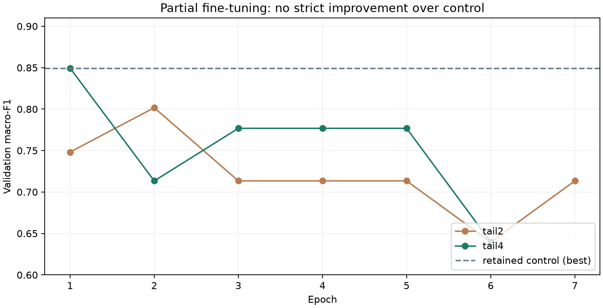

# 第四轮部分微调结果

2026-10-24，北京时间。已按用户授权完成真实训练和模型调整，并增加[本机拖拽识别页](local_demo.md)。**两组候选均未达到训练前的替换条件，继续使用v2_control。** 本轮没有新的独立测试准确率，也没有重跑已封存的29张或24张测试。

## 实际训练与选择

沿用v3的train201、val47及原类别规则，从control检查点初始化。两组仅改变解冻尾部模块数，分类头/尾部学习率0.0001/0.00003，全部特征BatchNorm运行统计冻结。预先限定两组、最多20轮、patience5、seed42、固定argmax，不再追加阈值或随机种子搜索。完整设计见[方案](goggles_finetuning_plan.md)、[训练前协议](goggles_finetuning_protocol.json)。

| 方案 | 实际轮数 / 更新 | 最佳轮 | 验证Accuracy | 验证macro-F1 | 佩戴Recall |
| --- | ---: | ---: | ---: | ---: | ---: |
| control，原基线 | 11 / 143（历史） | 3 | 91.49% | 0.8494 | 66.67% |
| tail2，解冻最后2模块 | 7 / 91 | 2 | 89.36% | 0.8017 | 55.56% |
| tail4，解冻最后4模块 | 6 / 78 | 1 | 91.49% | 0.8494 | 66.67% |

训练前固定规则要求候选macro-F1**严格超过**基线且佩戴Recall不下降。tail4虽将最佳验证加权损失从0.3465降到0.3166，但没有改变最佳轮的混淆矩阵`[[37,1],[3,6]]`，不因损失较低而临时修改选择规则。tail2为`[[37,1],[4,5]]`。最终决定与权重、运行记录SHA见[选定摘要](goggles_finetuning_selection.json)。

最深解冻范围先完成2轮26次更新短跑。所有运行均证实损失/梯度有限，冻结前部与全部特征缓冲区不变，允许训练的尾部和分类头真实更新，最佳权重重载预测一致。整段特征已经发生更新，因此`frozen_features_unchanged=false`是预期的真实记录，并非把整个骨干谎报为冻结。

运行使用项目原虚拟环境、PyTorch2.11.0+cu128及RTX3060 Laptop，CPU线程2，未安装新依赖。短跑耗时67.49秒，tail2为112.24秒、峰值已分配79.90MiB，tail4为110.64秒、94.91MiB；这些是训练记录范围的时间和显存，不含全部预检、文件核查及页面测试。

## 重载与页面检查

训练结束后，tail4最佳检查点独立加载并在同一47张验证集评价，Accuracy91.49%、macro-F1 0.8494、混淆矩阵`[[37,1],[3,6]]`，与训练记录相符。该操作为验证重载核验，不是新的保留测试。

本机接口分别对基线/tail4各预测4张既有验证头像，核对两类分数、图像SHA、验证集重复提示。另用未登记的纯色合成PNG检查未匹配分支，合成图不是真实头像，也不用于准确率评价。浏览器完成文件选择、两模型推理、超限错误提示及判断JSON下载；没有将检查头像称为未见过的新样本。

完整233项回归通过，覆盖旧数据/训练/评价路径及新增图片解码、真实HTTP、同源限制和静态路径隔离。新增HTTP回归首次在受限沙箱因回环连接权限失败，取得本机运行权限后完整通过，未跳过失败项。真实浏览器及API核验独立于测试中的替身推理引擎。

## 保存范围与限制

本地证据位于`results/classification/goggles_v4_smoke/`、`goggles_v4_tail2/`、`goggles_v4_tail4/`及`results/classification_evaluations/goggles_v4_tail4_validation/`。真实图像、权重和完整逐图报告不进入Git；本报告、配置和SHA摘要可同步。协议登记的37份旧模型、数据清单、评价和预测证据SHA全部保持不变。

当前部署候选仍为control，既往24张测试Accuracy79.17%、佩戴Recall50%仅属于第二轮历史结果，不能移作本次微调的测试结果。尾部微调增加了可训练参数，但在现有小规模、偏斜且来源有限的数据上没有取得验证收益。下一步若继续提高效果，应优先补充清晰的正类、多来源难例和另外的独立保留集，再安排有界实验；不围绕已封存测试反复调参。
