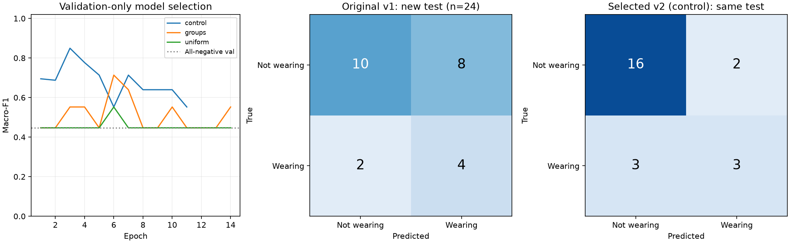

# 护目镜第二轮改进与公平比较

记录时间：2026-10-22T11:59:23.314354+00:00（UTC）。同一24张新保留头像上，Accuracy从58.33%变为79.17%（+20.83个百分点），macro-F1从0.5556变为0.7052。佩戴召回率从66.67%变为50.00%，存在取舍。

本轮按[训练前协议](goggles_improvement_protocol.json)完成数据扩充、短跑和三组对照，仅依据验证集锁定`control`，再用上述同一组图片各评价旧模型和选定模型一次。机器摘要见[改进状态](goggles_improvement_status.json)，原[第一轮29张测试结果](goggles_training_report.md)保留，未重新推理旧测试。

## 数据和执行

新增140张作者原图（224455039字节）及原VOC，实际查看全部原场景/头像预览，保留110张：佩戴18、未佩戴92，排除30张。普通眼镜、太阳镜和额头佩戴按原规则标未佩戴，不确定排除。仍为[SH17作者固定版本1](https://github.com/ahmadmughees/SH17dataset)，来源/许可/哈希见[来源记录](data_sources/sh17_expansion_140_20261022.json)，具体方法见[改进方案](goggles_improvement_plan.md)。

累计301张有效头像；29张旧测试封存，其余272张构成v3：训练201（未佩戴157、佩戴44）、验证47（38/9）、新测试24（18/6）。训练来源组由12增至72，佩戴来源组由3增至8；新test有20个来源组，6个佩戴样本来自4组。旧train/val用途不变，新组按种子20261023整组分配，数据指纹`5859b079a61f07f9436f5a7c75383d9c8854fe73fb98c0211cb4045643ae550c`。

原图/头像/标签/旧划分没有覆盖。新测试在ID、显式来源组、PNG字节、像素和原图字节上与旧全部191张无已知交叉；涉及新增项的跨组dHash≤3或pHash≤6候选为0。数字桶、哈希与视觉场景复核不保证未知摄影者或人物关系完全独立。

代码版本`559e2cc`，212项累计回归通过。新uniform短跑2轮26次更新通过有限损失、骨干冻结、分类头更新和最佳权重重载后，三组实验各自从同一ImageNet权重独立开始；冻结MobileNetV3 Small骨干、224填充、batch16、AdamW lr0.0003、最多30轮、patience8、种子42保持相同。未安装依赖，未用短跑权重接着训练。

## 验证集选择

control沿用逐图shuffle及训练频数类别权重；groups改成来源组均衡且保留类别权重；uniform使用来源组均衡且类别权重全1。两组来源均衡实验中，每个来源组的抽样权重之和相同，有放回每轮201次；重复抽样不算新增独立样本，val/test不增强或重采样。

| 候选 | 完成轮数 | 最佳轮次 | 验证Accuracy | 验证macro-F1 | 佩戴Recall |
| --- | ---: | ---: | ---: | ---: | ---: |
| control | 11 | 3 | 91.49% | 0.849359 | 66.67% |
| groups | 14 | 6 | 87.23% | 0.713415 | 33.33% |
| uniform | 14 | 6 | 82.98% | 0.552381 | 11.11% |

按协议最高验证macro-F1、再按该轮Accuracy、仍同分按候选顺序选择`control`。选择记录在任何新测试前写入[锁定文件](goggles_improvement_selection.json)；重新加载最佳权重后验证指标一致。未选模型未接触新test，预测规则固定argmax，不根据新test改模型、参数或阈值。

来源均衡没有在本次验证中带来额外收益。按冻结训练标签计算，它将佩戴样本的期望抽样占比从逐图抽样的21.89%降至约10.09%，工厂组每轮期望约2.79张；uniform又取消类别加权。这改变了训练类别分布，与更低佩戴召回率的现象一致，但不能单独证明全部差异都由这一因素造成。

## 同一新保留集的比较

| 模型 | 数量 | Accuracy | macro-F1 | 佩戴Precision | 佩戴Recall |
| --- | ---: | ---: | ---: | ---: | ---: |
| 原v1 | 24 | 58.33% | 0.555556 | 33.33% | 66.67% |
| 选定v2（control） | 24 | 79.17% | 0.705160 | 60.00% | 50.00% |
| 全预测未佩戴参考 | 24 | 75.00% | 0.428571 | 0.00% | 0.00% |

Accuracy变化为+20.83个百分点，macro-F1变化为+0.149604；两行模型使用相同、相同顺序的新24张样本，不能把这里的结果与第一轮旧29张测试的62.07%直接相减作为提升。

| 模型 | 类别 | 真实数量 | Precision | Recall | F1 |
| --- | --- | ---: | ---: | ---: | ---: |
| 旧v1 | 未佩戴 | 18 | 83.33% | 55.56% | 66.67% |
| 旧v1 | 佩戴 | 6 | 33.33% | 66.67% | 44.44% |
| 选定v2 | 未佩戴 | 18 | 84.21% | 88.89% | 86.49% |
| 选定v2 | 佩戴 | 6 | 60.00% | 50.00% | 54.55% |

混淆矩阵按“真实为行、预测为列，类别顺序未佩戴/佩戴”：旧模型`[[10, 8], [2, 4]]`，选定模型`[[16, 2], [3, 3]]`。未佩戴误判佩戴由8张变为2张；佩戴漏判由2张变为3张。新模型错误ID：`sh17_p10871712`, `sh17_p375903`, `sh17_p209271`, `sh17_p9875406`, `sh17_p9875418`。

本次提升主要来自减少未佩戴样本的误报，佩戴Recall下降，不能描述为所有指标全面提高。新模型Accuracy仅比全负类参考高4.17个百分点，但macro-F1更高，确实识别出3张佩戴。样本较少，后续仍需提高佩戴识别覆盖并验证这种取舍是否符合实际需求。

选定权重本地路径`results/classification/goggles_v2_control/best.pt`，SHA256`c66432ef67e71efb9341c7aceed7a2291e1f45cf4de313548ad3d9a03c6be8d7`。验证集4张头像（两类各2张）的图片预测入口实际核验通过，输出类别和分数，无位置框；这4张不是额外独立测试。旧模型、旧测试指标和原一次性标记的SHA保持不变；新增benchmark用新指纹的一次性标记保留，不能重置旧测试。

## 适用范围

本轮是一次小规模、单种子的对照尝试。新测试只有6个正例，单张错误影响佩戴召回率16.67个百分点；相同来源组内样本也有关联。即使观察到提高，也不声称统计显著或实际实验室可部署。

样本复核由Codex完成，尚无独立第二标注者、真实实验室场景验证或分数校准。剩余工作应优先增加独立场景、佩戴类型及姿态覆盖并复标，用新的保留数据评价后续选择。不得继续围绕本次24张调参。原图、头像、权重和完整逐图结果只存本地；Git仅同步代码、配置、元数据、聚合图表与报告。
