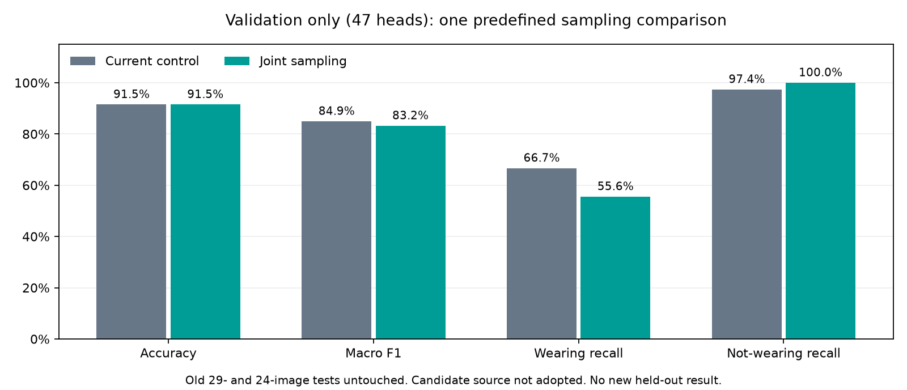

# 第三轮联合均衡对照与新来源核查

记录时间：2026-10-23T15:57:05.578507+00:00（UTC）。本轮完成两轮短跑和唯一一个完整候选，**只报告验证结果，没有新的独立测试结果**。新候选未达到预先固定的验证选择规则，继续保留control，不追加种子、阈值或超参数试验。

## 固定方案与真实执行

代码版本`b2cd009`；215项累计回归通过。配置与选择规则在[协议](goggles_joint_sampling_protocol.json)中预先固定，详见[方案](goggles_joint_sampling_plan.md)。原v3数据272张（训练201、验证47、旧新测试24）保持不变；29张旧测试和24张已评价测试均未重新推理，也未加入训练。

联合策略让每类总抽样权重相等，再在每类内均分给来源组和图片；期望两类各50%，每轮仍有放回抽201次。损失不再类别加权，避免双重均衡；模型、初始权重、冻结骨干、输入增强、学习率与种子均按协议保持原设置。

先完成两份匹配CUDA零更新预检，再短跑2轮26次更新，通过有限损失、骨干参数/缓冲区不变、分类头更新及最佳权重重载后才启动完整候选。完整运行10轮、130次更新，第2轮验证macro-F1最佳；骨干冻结、头更新与最佳权重重载全部通过，峰值已分配显存76.53MiB。没有安装依赖或接续短跑权重训练。

## 相同验证集比较

| 模型 | Accuracy | macro-F1 | 佩戴Recall | 未佩戴Recall |
| --- | ---: | ---: | ---: | ---: |
| 当前control | 91.49% | 0.849359 | 66.67% | 97.37% |
| 联合均衡候选 | 91.49% | 0.832143 | 55.56% | 100.00% |

混淆矩阵按真实为行、预测为列，顺序未佩戴/佩戴：control为`[[37, 1], [3, 6]]`，joint为`[[38, 0], [4, 5]]`。验证集只有9个佩戴正例；这些结果用于选择方案，不能代替独立测试，也不能与旧24张测试上的79.17%直接比较。

选择记录见[锁定结果](goggles_joint_sampling_selection.json)，完整证据哈希和状态见[摘要](goggles_joint_sampling_status.json)。旧33份实验、权重、预测及数据证据SHA均不变，本轮模型没有最终测试标记。当前对外基线及其测试结果继续以[第二轮报告](goggles_improvement_report.md)为准。

## 新来源没有直接并入

核查[官方Construction-PPE](https://docs.ultralytics.com/datasets/detect/construction-ppe)，发布方声明AGPL-3.0。固定GitHub资产ID290535885（178,415,813字节ZIP），只通过有界HTTP Range获取100张原图及其原YOLO标注，原图15,695,007字节；成员CRC32、图像解码与逐文件SHA通过。保留发布方整包摘要，但未下载整包，不能声称整包哈希已验证。

全部9张原场景/头像拼图实际查看，另打开4张原分辨率疑难头像。60个上游goggles候选中，仅2张能明确支持保护眼部的外观判断，4张是普通眼镜或太阳镜，54张因防护类型不清或模糊排除；其中52张是同一屋顶序列的重复/增强变体，且跨上游train/val/test。剩余40个no_goggle候选均为未佩戴状态候选。此计数只描述本次有界选样，不能推断整个上游数据集错误率。

因此只记录2个佩戴、44个未佩戴状态候选与54个排除项；头部框仍需单独几何审核，**没有生成新的冻结头像或分类版本，也没有加入当前训练或充当独立测试集**。详细原图/标注SHA见[来源记录](data_sources/construction_ppe_review_100_20261023.json)，逐项判断见[状态核查](data_sources/construction_ppe_state_review_20261023.json)。不能因为图像数量增加就声称来源独立性或准确率提高。

## 后续的具体缺口

当前仍缺足够且独立的真实护目镜正例、第二位标注者和实际实验室图像，以及课程明确的验收指标。下一轮数据应优先补充不同场景/采集系列中的真实佩戴正例与普通眼镜、额头佩戴等难负例；按整组划分、复标和近重复检查后再建立新版本。若需评价新方案，应另设未使用保留集；本轮停止追加模型或阈值试验。
