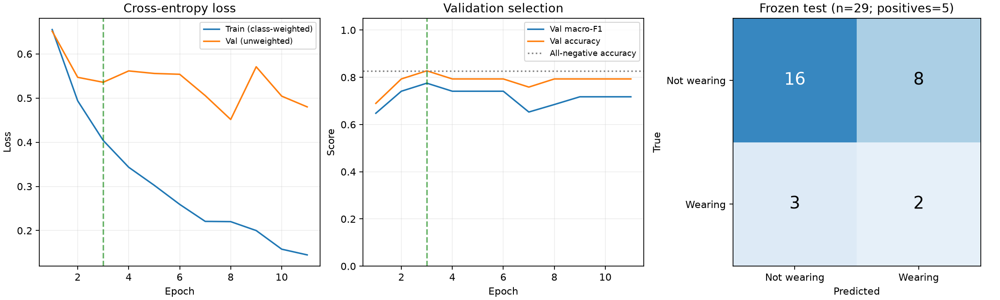

# 护目镜小样本基线训练与最终评价

记录时间：2026-10-22T18:36:17+08:00（北京时间）。状态：两轮短跑、基线、验证重评、静态头像预测和一次冻结测试均已完成。代码版本`8b31757`，可复核摘要见[训练状态](training_status.json)，过程约束见[训练流程](classification_training_workflow.md)。

## 数据和执行

沿用180张原图、191张复核头像及133/29/29冻结划分；未修改原件、标签、裁剪、来源组或划分。训练97张未佩戴/36张佩戴，验证和测试各24/5。数据指纹`b9176dd923d011a63f7373e126d0997f9959c2e324debc20117140013250e7af`。

MobileNetV3 Small从ImageNet权重初始化，冻结特征骨干及BatchNorm，仅训练592898个分类头参数。224等比例填充、batch16、AdamW学习率0.0003、种子42；类别权重仅由训练频数计算。短跑与基线独立从初始权重开始，短跑权重未被用于基线。

| 运行 | 完成轮数 | 优化器更新 | 最佳轮次 | 最佳验证macro-F1 | 训练入口内耗时 | 运行峰值已分配显存 |
| --- | ---: | ---: | ---: | ---: | ---: | ---: |
| 短跑 | 2 | 18 | 2 | 0.741071 | 46.87秒 | 76.53MiB |
| 基线 | 11/30 | 99 | 3 | 0.775194 | 84.82秒 | 76.53MiB |

耗时从创建训练记录后计时，不含入口前的数据核查；显存包含训练及检查点重载验证，不等于整机GPU占用。两次运行损失均有限、骨干参数/缓冲区哈希不变、分类头改变；最佳检查点重载后探针logits一致。203项累计回归通过；短跑证据满足18次更新后才启动基线。

按验证macro-F1严格提高选最佳，同分保留较早轮次；基线连续8轮未提高，触发早停。重新加载最佳权重得到的验证macro-F1与选模记录一致。测试未参与训练、轮次选择、超参数或阈值选择，预测规则预先固定为argmax。

图中训练loss有类别权重，验证loss无类别权重；两条损失曲线的数值口径不同。虚线标出最佳轮次。

## 验证和最终测试结果

| 集合 | Accuracy | macro-F1 | 数量 |
| --- | ---: | ---: | ---: |
| 验证 | 82.76% | 0.775194 | 29 |
| 最终测试 | 62.07% | 0.505426 | 29 |
| 全预测未佩戴的参考基线 | 82.76% | 0.452830 | 29 |

| 集合 | 类别 | 真实数量 | Precision | Recall | F1 |
| --- | --- | ---: | ---: | ---: | ---: |
| 验证 | 未佩戴 | 24 | 100.00% | 79.17% | 88.37% |
| 验证 | 佩戴 | 5 | 50.00% | 100.00% | 66.67% |
| 测试 | 未佩戴 | 24 | 84.21% | 66.67% | 74.42% |
| 测试 | 佩戴 | 5 | 20.00% | 40.00% | 26.67% |

测试混淆矩阵，行是真实、列是预测：

| 真实\预测 | 未佩戴 | 佩戴 |
| --- | ---: | ---: |
| 未佩戴 | 16 | 8 |
| 佩戴 | 3 | 2 |

测试错误头像ID：`sh17_p3760930`, `sh17_p3869180`, `sh17_p4489706`, `sh17_p4492080`, `sh17_p6197036`, `sh17_p7550433`, `sh17_p8761657`, `sh17_p9062781`, `sh17_p5466163`, `sh17_p9242803`, `sh17_p9242855`。真实未佩戴却判佩戴为8张，真实佩戴却判未佩戴为3张。完整逐图真实标签、预测标签和两类分数保存在本地最终测试报告。

本次测试效果较弱：Accuracy低于全预测未佩戴的参考值；macro-F1虽略高于该参考，佩戴Precision只有20%、Recall只有40%，不能视为稳定可用。训练loss持续下降而验证macro-F1在第3轮后没有提高，结合较弱测试表现，提示过拟合或场景差异；本次实验不足以区分各因素的贡献。

测试完成后，Codex只读抽看4个错误头像：`sh17_p3760930`、`sh17_p4492080`为低头且未佩戴却误报；`sh17_p5466163`、`sh17_p9242803`可见覆盖眼部的防护镜，却在低头/侧向姿态被漏判。这是4例事后观察，不代表全部错误的原因，没有修改标签或追加模型推理。

最终测试运行已写入一次性记录；评价后没有改模型、轮次、阈值或数据，也没有重跑测试。最佳权重本地路径`results/classification/goggles_v1_baseline/best.pt`，SHA256为`ab649ad5020a80e9f0edcd00a9fe75e808b4ed3e3df2d29bc6a4d0e06f4737eb`。

## 预测与证据

使用验证集头像核验单张入口1张、目录入口4张（两类各2张），均成功输出佩戴状态、两类softmax分数、输入哈希和尺寸，不输出框；JSONL数量/顺序与输入一致。此演示复用了验证样本，不是额外独立测试。

完整证据仅保存在本地：`results/classification/`、`results/classification_evaluations/`、`results/classification_predictions/`。公开同步代码、配置、聚合图表、指标摘要及独立日志；不上传原图、头像、完整逐图结果或权重。各证据文件摘要记录在[训练状态](training_status.json)。本轮未安装依赖。

## 结果的适用范围

当前为小样本基线。训练133张仅12个显式来源组，佩戴正例覆盖3组，工厂来源占120/133；val/test来自其他SH17来源组。每个评价集只有5个佩戴样本，错1张即改变佩戴召回率20个百分点，指标不稳定。

尚无独立第二标注者复核、实际实验室场景验证或课程效果合格门槛；分数未经校准，外观判断不能认证防护等级。来源组无交叉不证明未知人物/摄影者关系完全独立。后续提升应使用新的独立样本和新版本，保留本次冻结测试及其结果，避免围绕这29张测试样本调参。
